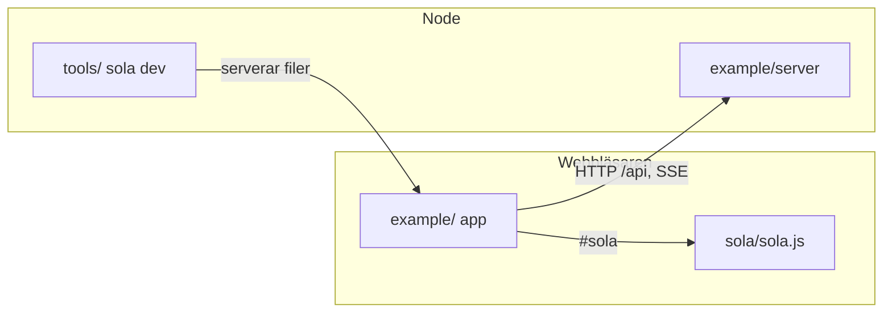
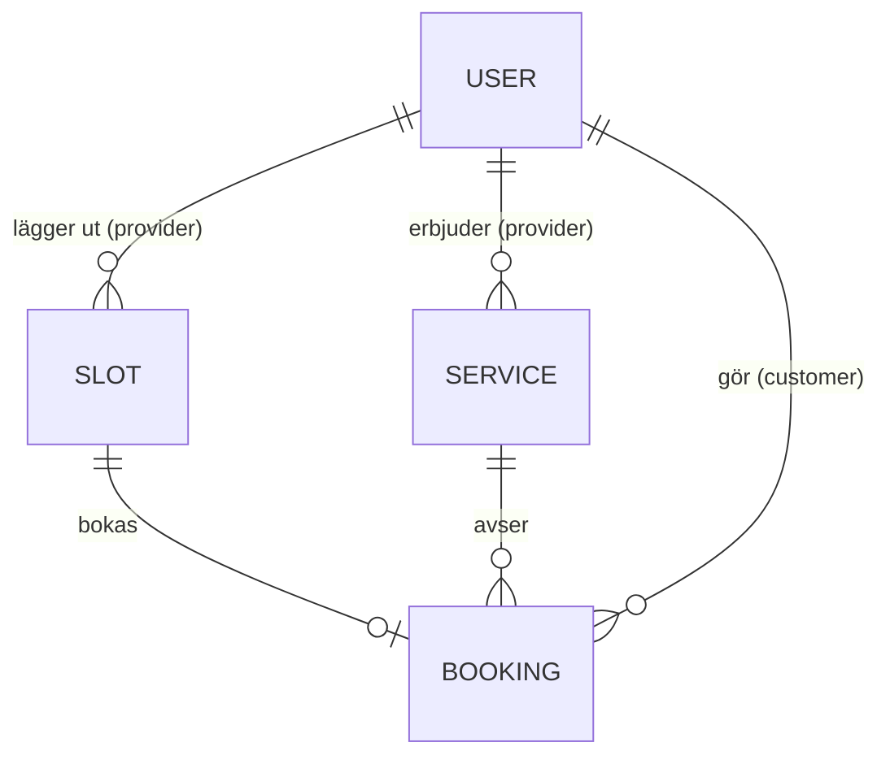

# Architecture Spine — Sola

## Design Paradigm

**Extraherat ramverk.** Exempelappen byggs i ren HTML/JS/CSS; en lösning som skrivs för andra gången flyttas till ramverket. Tre enheter, ett repo, beroenden åt ett håll:

| Enhet | Katalog | Körs i | Innehåller |
| --- | --- | --- | --- |
| Sola | `sola/` | Webbläsaren | `sola.js` – hela runtime |
| Verktyg | `tools/` | Node | CLI: `sola dev` (filservering, live reload), senare `test`, `build`, `update` |
| Exempelapp | `example/` | Webbläsaren + Node | Bokningsappen och dess API-server |



## Invariants & Rules

### AD-1 — Tre enheter och beroenderiktning [ADOPTED]

- **Binds:** all
- **Prevents:** ramverkskod i appen, appkunskap i ramverket, Node-kod i webbläsaren.
- **Rule:** `example/` får bero på `sola/` och endast via specifiern `#sola`. `sola/` importerar aldrig från `example/` eller `tools/`. `tools/` laddas aldrig i webbläsaren och importerar aldrig från `example/`.

### AD-2 — Noll beroenden, inget byggsteg [ADOPTED]

- **Binds:** all
- **Prevents:** att ett paket eller en kompilering smyger in i en enhet.
- **Rule:** Inga npm-beroenden, inte heller devDependencies. Inget i repot kräver att källkoden transformeras innan den körs. Endast Node och webbläsarens egna API:er.

### AD-3 — Sola är en fil med namngivna exporter [ADOPTED]

- **Binds:** sola, example
- **Prevents:** djupimporter och ett oavsiktligt publikt API.
- **Rule:** Hela runtime ligger i `sola/sola.js`. Endast dess namngivna exporter är publikt API. Appen importerar ingenting annat från Sola än `#sola`.

### AD-4 — Utbrytning sker i en ändring [ADOPTED]

- **Binds:** sola, example
- **Prevents:** samma lösning som lever både i appen och i Sola.
- **Rule:** En lösning bryts ut först när den skrivs för andra gången. Utbrytningen flyttar den till `sola.js` och byter alla förekomster i appen till `#sola` i samma commit. Parallella kopior är förbjudna. Inget testkrav vid utbrytning – exempelappen är integrationstestet.

### AD-5 — Devservern är delad i två [ADOPTED]

- **Binds:** tools, example
- **Prevents:** API-logik i ramverkets verktyg, eller filservering som bara fungerar för exempelappen.
- **Rule:** Filservering och live reload är generiska och ligger i `tools/` (`sola dev`). Appens API ligger i `example/server/` och ska kunna ersättas av Spola utan ändring i appen.

### AD-6 — API-kontraktet [ADOPTED]

- **Binds:** example, Spola
- **Prevents:** att Node-servern och Spola svarar olika.
- **Rule:** JSON utan omslag. Fel som RFC 9457 Problem Details (`application/problem+json` med `type`, `title`, `status`, `detail`). Id är opaka strängar som klienten aldrig tolkar. Datum är ISO 8601 med offset. Ändringshändelser skickas som Server-Sent Events på `GET /api/events`.

### AD-7 — Session och behörighet [ADOPTED]

- **Binds:** example, Spola
- **Prevents:** tokens i webbläsarlagring och behörighet som bara finns i klienten.
- **Rule:** Sessionen är en HttpOnly-cookie som servern sätter. `401` betyder utloggad och `403` saknar behörighet, båda som Problem Details. Servern kontrollerar behörighet på varje anrop; guards i klienten är bara UX.

### AD-8 — Servern är facit [ADOPTED]

- **Binds:** example
- **Prevents:** vyer som visar olika tillstånd för samma bokning eller tid.
- **Rule:** Ingen vy äger delad data. En vy hämtar sin data när den visas och hämtar om efter varje egen ändring. En SSE-händelse betyder bara "något ändrades" och utlöser omhämtning. Ingen optimistisk uppdatering, ingen delad klientcache.

### AD-9 — `api.js` är enda vägen till servern [ADOPTED]

- **Binds:** example
- **Prevents:** egna `fetch`-anrop och egen felhantering per vy.
- **Rule:** Endast `example/api.js` anropar `fetch`. Den exporterar en namngiven funktion per API-anrop (`getSlots`, `createBooking` …), tolkar Problem Details och skickar användaren till `/login` vid `401`. Vyer innehåller inga API-sökvägar.

### AD-10 — `app.js` äger routes och guards [ADOPTED]

- **Binds:** example
- **Prevents:** routes som definieras på flera ställen och vyer som binds ihop.
- **Rule:** Routetabellen och guards finns endast i `example/app.js`. Varje route har en vymodul i `example/views/` som laddas med `import()`. Vyer importerar aldrig varandra; delad kod går via `example/components/`, `example/api.js` eller `#sola`.

### AD-11 — Engelska i koden [ADOPTED]

- **Binds:** all
- **Prevents:** blandspråk och å/ä/ö i URL:er, fält och jämförelser.
- **Rule:** Identifierare, JSON-fält, routes, API-sökvägar, statusvärden samt fil- och katalognamn är på engelska. Svenska förekommer endast i dokumentation och i texter som visas för användaren.

### AD-12 — Webbläsarstöd: Baseline 2026 [ADOPTED]

- **Binds:** sola, example
- **Prevents:** reservkod och två olika routingvägar.
- **Rule:** Sola och appen använder Navigation API och URLPattern direkt. Ingen History API-fallback och inga polyfills.

## Consistency Conventions

| Concern | Convention |
| --- | --- |
| Filer och kataloger | kebab-case: `time-slot.js`, `my-bookings.js` |
| JavaScript | camelCase för variabler och funktioner, PascalCase för komponenter |
| Routes och API-sökvägar | gemener, substantiv i plural: `/providers/:id`, `/api/bookings/:id` |
| JSON-fält | camelCase: `providerId`, `startsAt` |
| Statusvärden | gemena engelska strängar: `pending`, `confirmed`, `rejected`, `cancelled` |
| Fel | RFC 9457 Problem Details (AD-6) |
| Datum | ISO 8601 med offset (AD-6) |

## Stack

| Name | Version |
| --- | --- |
| Node | 22 LTS eller senare |
| Webbläsare | Baseline 2026 (Navigation API, URLPattern) |
| Beroenden | inga |

## Structural Seed

```text
sola/
  sola.js            # hela runtime (växer genom utbrytning)
tools/
  sola.mjs           # CLI; först: sola dev
example/
  index.html         # import map: "#sola" -> /sola/sola.js
  app.js             # routetabell, guards, start
  api.js             # en funktion per API-anrop
  style.css
  components/        # delade komponenter
  views/             # en modul per route
  server/            # API, data i minnet, SSE
docs/
```



Roller: `customer` (brukare) och `provider` (utförare).

## Capability → Architecture Map

| User story ([docs/user-stories.md](../../../docs/user-stories.md)) | Lives in | Governed by |
| --- | --- | --- |
| 1–3 Låg förvaltning, uppgradering via import map, läsbart | `sola/sola.js`, `example/index.html` | AD-2, AD-3 |
| 4 Inga tredjepartsberoenden | hela repot | AD-2 |
| 5 Ingen `innerHTML` | `sola/sola.js` | Deferred: mallsäkerhet bryts ut med `html` |
| 6 Statiska filer, strikt CSP | `tools/`, `example/` | AD-2 |
| 7 Börja med tre filer | `example/` | AD-4 |
| 8 Automatisk uppdatering | `sola/sola.js` (signals) | AD-4, AD-8 |
| 9 Vyer som laddas vid behov | `example/app.js`, `example/views/` | AD-10 |
| 10 Tester i Node | `tools/` | Deferred |
| 11 Litet, stabilt API | `sola/sola.js` | AD-3, AD-4 |
| 12 Gemensamt med Spola | `example/server/` | AD-6, AD-7 |

## Deferred

| Beslut | Varför det kan vänta |
| --- | --- |
| Solas API-form (`signal`, `html`, router m.m.) | Växer fram genom utbrytning (AD-4). |
| Tester för `sola.js` | Exempelappen täcker under bygget; skrivs senast före första release. |
| DOM-tester i headless Chrome | Sist i prioriteringen enligt designen. |
| Delad klientcache, optimistisk uppdatering | Bryts ut om samma cachelogik skrivs två gånger (AD-8). |
| Formulärlager | Bryts ut när två vyer behöver samma formulärlogik. |
| CSS-konvention | Bestäms när komponenternas stilar börjar krocka. |
| Distribution och versioner | Först vid första release. |
| Integration med Spola | Kontraktet är fastlagt (AD-6, AD-7); själva bytet sker när Spola har motsvarande API. |
| Driftsättning och miljöer | Endast lokal utveckling med `sola dev` tills appen ska köras på riktigt. |
| SSR | Inget behov i en app bakom inloggning. |
| Persistens på servern | Data i minnet räcker för exempelappen; Spola tar över. |
