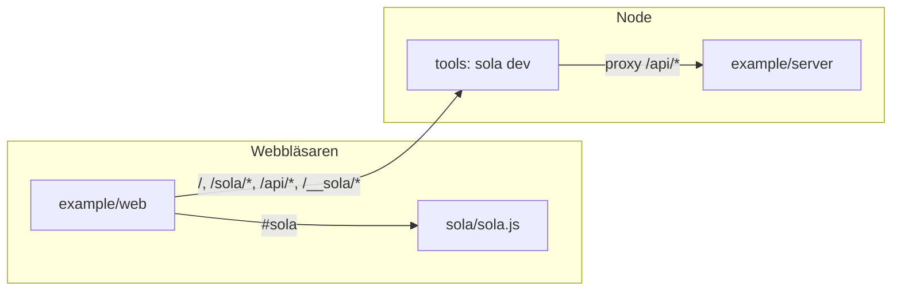
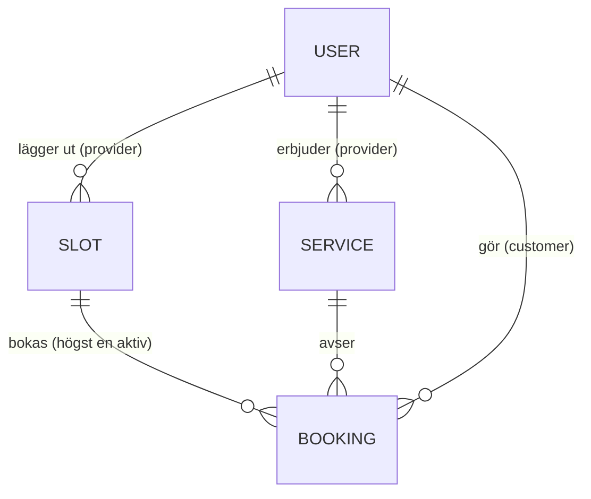

# Architecture Spine — Sola

## Design Paradigm

**Extraherat ramverk.** Exempelappen byggs i ren HTML/JS/CSS; en lösning som skrivs för andra gången flyttas till ramverket. Tre enheter, ett repo, beroenden åt ett håll:

| Enhet | Katalog | Körs i | Innehåller |
| --- | --- | --- | --- |
| Sola | `sola/` | Webbläsaren (och Node vid test) | `sola.js` – hela runtime |
| Verktyg | `tools/` | Node | CLI: `sola dev` (filservering, live reload, proxy), senare `test`, `build`, `update` |
| Exempelapp | `example/` | `web/` i webbläsaren, `server/` i Node | Bokningsappen och dess API-server |



## Invariants & Rules

### AD-1 — Tre enheter och beroenderiktning [ADOPTED]

- **Binds:** all
- **Prevents:** ramverkskod i appen, appkunskap i ramverket, Node-kod i webbläsaren.
- **Rule:** `example/web/` får bero på `sola/` och endast via specifiern `#sola`. `sola/` importerar aldrig från `example/` eller `tools/` och innehåller inga app-routes, API-sökvägar, domänfält, statusvärden eller svenska texter – sådant skickas in som argument. `tools/` laddas aldrig i webbläsaren och importerar aldrig från `example/`.

### AD-2 — Noll beroenden, inget byggsteg [ADOPTED]

- **Binds:** all
- **Prevents:** att ett paket eller en kompilering smyger in i en enhet.
- **Rule:** Inga npm-beroenden, inte heller devDependencies. Inget i repot kräver att källkoden transformeras innan den körs. Endast Node och webbläsarens egna API:er.

### AD-3 — Sola är en fil med namngivna exporter [ADOPTED]

- **Binds:** sola, example
- **Prevents:** djupimporter, ett oavsiktligt publikt API och ett ramverk som inte kan laddas i Node.
- **Rule:** Hela runtime ligger i `sola/sola.js`. Endast dess namngivna exporter är publikt API. Appen importerar ingenting annat från Sola än `#sola`. Att importera `sola.js` rör inte DOM; DOM används först när en export anropas.

### AD-4 — Utbrytning sker i en ändring, en i taget [ADOPTED]

- **Binds:** sola, example
- **Prevents:** samma lösning på två ställen, två namn för samma sak och krockande utbrytningar.
- **Rule:** En lösning bryts ut först när den skrivs för andra gången. Utbrytningen flyttar den till `sola.js` och byter alla förekomster i appen till `#sola` i samma commit; parallella kopior är förbjudna. Utbrytningar görs en i taget. Namn tas från `docs/design.md` när de finns där (`signal`, `computed`, `effect`, `html`, `mount`, `define`). En export har ett namn och en form; ändras den uppdateras alla anrop i samma commit. Upprepning inom `api.js` blir en privat hjälpare i `api.js`, inte Sola-API. Inget testkrav vid utbrytning – exempelappen är integrationstestet.

### AD-5 — En origin i utveckling, `sola dev` är generisk [ADOPTED]

- **Binds:** tools, example, Spola
- **Prevents:** cross-origin-cookies, serverkod som serveras statiskt, djuplänkar som ger 404 och att verktyget och appen känner till varandra.
- **Rule:**
  - Appens statiska filer ligger i `example/web/`. `example/server/` serveras aldrig.
  - `sola dev <root> [--mount <prefix>=<dir>]… [--api <url>]` serverar `<root>` på `/`, monterar kataloger (exemplet: `--mount /sola/=sola/`), proxar `/api/*` oförändrat till `--api` inklusive cookies och strömmande SSE, och svarar med `<root>/index.html` på GET med `Accept: text/html` som inte matchar en fil.
  - Verktygets egna sökvägar ligger under `/__sola/`. Verktyget injicerar själv sin reload-klient som extern modul; ingen fil i `example/` känner till `/__sola/`. CSS byts utan omladdning.
  - Alla URL:er i `index.html` är rotrelativa (`/app.js`, `/style.css`). Inga app-routes börjar med `/api/`, `/sola/` eller `/__sola/`.
  - Även i drift ligger appen och API:t på samma origin.

### AD-6 — API-kontraktet [ADOPTED]

- **Binds:** example, Spola
- **Prevents:** att Node-servern och Spola svarar olika.
- **Rule:**
  - JSON utan omslag. Id är opaka strängar som klienten aldrig tolkar.
  - Tid skickas alltid i UTC med `Z`. `from`/`to` är tidpunkter med `Z`, halvöppet intervall: `from` ingår, `to` ingår inte. Klienten jämför aldrig tidssträngar utan tolkar dem och räknar dygn i webbläsarens lokala zon.
  - Fel är RFC 9457 Problem Details (`application/problem+json`). `type` är `/problems/<namn>` ur listan: `invalid-credentials`, `validation`, `slot-taken`, `invalid-transition`, `not-found`, `forbidden`, `unauthorized`. Valideringsfel har tillägget `errors: [{ field, message }]`.
  - Klienten visar egna svenska texter valda efter `type` och `field`; serverns `title` och `detail` visas aldrig för användaren.

### AD-7 — Session och behörighet [ADOPTED]

- **Binds:** example, Spola
- **Prevents:** tokens i webbläsarlagring, CSRF och behörighet som bara finns i klienten.
- **Rule:** Sessionen är en cookie med `HttpOnly; SameSite=Lax; Path=/`, plus `Secure` utanför localhost. Skrivande anrop kräver `Content-Type: application/json` och ett `Origin` som matchar servern. `401` betyder utloggad och `403` saknar behörighet, båda som Problem Details. Servern kontrollerar behörighet på varje anrop; guards i klienten är bara UX.

### AD-8 — Servern är facit [ADOPTED]

- **Binds:** example
- **Prevents:** vyer som visar olika tillstånd för samma bokning eller tid.
- **Rule:** Ingen vy äger delad data. En vy hämtar sin data när den visas och hämtar om efter varje egen ändring och varje händelse (AD-17). Ingen optimistisk uppdatering och ingen delad klientcache. Enda undantaget är `currentUser` (AD-16).

### AD-9 — `api.js` är enda vägen till servern [ADOPTED]

- **Binds:** example
- **Prevents:** egna `fetch`-anrop, egen felhantering och egna händelseanslutningar per vy eller komponent.
- **Rule:** Endast `example/web/api.js` anropar `fetch` och öppnar `EventSource`. Den exporterar en namngiven funktion per API-anrop (`getSlots`, `createBooking` …) och avvisar fel med ett `Problem`-objekt. Vyer innehåller inga API-sökvägar. 401-hantering följer AD-16.

### AD-10 — `app.js` äger routes och guards [ADOPTED]

- **Binds:** example
- **Prevents:** routes som definieras på flera ställen och vyer som binds ihop.
- **Rule:** Routetabellen och guards finns endast i `example/web/app.js`. Guards körs innan vyns `import()`. Varje route har en vymodul i `example/web/views/` som laddas med `import()`. Vyer importerar aldrig varandra; delad kod går via `components/`, `api.js`, `session.js` eller `#sola`.

### AD-11 — Engelska i koden [ADOPTED]

- **Binds:** all
- **Prevents:** blandspråk och å/ä/ö i URL:er, fält och jämförelser.
- **Rule:** Identifierare, JSON-fält, routes, API-sökvägar, statusvärden samt fil- och katalognamn är på engelska. Svenska förekommer endast i dokumentation och i texter som visas för användaren.

### AD-12 — Webbläsarstöd [ADOPTED]

- **Binds:** sola, example
- **Prevents:** reservkod och två olika routingvägar.
- **Rule:** Lägsta version: Chrome och Edge 102, Firefox 147, Safari och iOS 26.2. Navigation API och URLPattern används direkt. All navigering sker via `navigation.navigate`, aldrig `location.href`. Ingen History API-fallback och inga polyfills.

### AD-13 — Domänkontraktet ligger i ryggraden [ADOPTED]

- **Binds:** example, Spola
- **Prevents:** att server, `api.js`, vyer och Spola översätter domänen var för sig.
- **Rule:** Entiteter, fält, statusvärden, routes och API-sökvägar har exakt namnen i [Domänkontrakt](#domänkontrakt). Där `docs/exempelapp.md` säger annat gäller ryggraden. Ett nytt fält eller en ny sökväg läggs till i tabellen i samma ändring som koden. Läsningar av `Booking` bäddar in `slot` och `service` som hela objekt och `customer`/`provider` som `{ id, name }`; skrivningar tar bara id. Härledda fält (`available`) går inte att skriva.

### AD-14 — Vymodulens kontrakt [ADOPTED]

- **Binds:** example (`app.js`, `views/`)
- **Prevents:** vyer som routern inte kan anropa, gamla svar som skriver över nya och lyssnare som överlever sin vy.
- **Rule:** Varje vymodul har en enda export: `export default async function View({ params, query, signal })` som returnerar en `Node`. `signal` är en `AbortSignal` som `app.js` avbryter när vyn lämnas; alla lyssnare, timrar, prenumerationer och API-anrop binds till den. Vyn laddar data med en `load()` där varje nytt anrop avbryter det förra. Ändrade parametrar ger en ny vyinstans.

### AD-15 — Komponenter och DOM [ADOPTED]

- **Binds:** example, sola
- **Prevents:** inkompatibla komponentformer, komponenter som hämtar data och XSS innan `html` finns.
- **Rule:** En komponent är en funktion `PascalCase(props)` som returnerar en `Node`, får data via props och rapporterar via callbacks. Bara vyer anropar `api.js`. `innerHTML`, `outerHTML`, `insertAdjacentHTML`, `document.write`, `eval` och inline-händelseattribut är förbjudna i `example/` och `sola/` från första raden; text sätts med `textContent` eller noder. Enda undantaget: `sola.js` får tolka de statiska strängdelarna i en tagged template via ett `<template>`-element.

### AD-16 — Inloggad användare och 401 [ADOPTED]

- **Binds:** example
- **Prevents:** flera ägare av den inloggade användaren, omdirigeringsloopar och öppna omdirigeringar.
- **Rule:**
  - `example/web/session.js` äger `currentUser` och exporterar läsning, `setUser` och `onUnauthorized`. `app.js` sätter värdet från `getMe()` vid start och efter `login()`/`logout()`. Vyer läser men skriver aldrig, utom inloggningsvyn via `setUser`.
  - `getMe()` ger `null` vid 401. `login()` avvisar med `Problem` (`invalid-credentials`). I inget av fallen omdirigerar `api.js`.
  - Andra 401 anropar `onUnauthorized`, som navigerar till `/login?next=<pathname+search>`.
  - `next` följs bara om det börjar med `/` men inte `//`. Fel roll skickas till `/`, inte `/login`.

### AD-17 — Händelseströmmen [ADOPTED]

- **Binds:** example, Spola
- **Prevents:** händelser som ingen lyssnar på, för många anslutningar och inaktuell data efter återanslutning.
- **Rule:** `GET /api/events` skickar bara namnlösa händelser med `data: {"type":"<entity>.changed","id":"<id>"}`, där `entity` är `booking` eller `slot`. Varje skrivning ger en händelse till alla berörda användare. Utan session svarar servern 401 innan strömmen öppnas. `api.js` äger den enda `EventSource` per flik, exporterar `onChange(listener, { signal })` och anropar lyssnaren vid varje händelse och varje (åter)anslutning. Strömmen stängs vid `logout()` och `pagehide`.

### AD-18 — Bokningens tillstånd [ADOPTED]

- **Binds:** example, Spola
- **Prevents:** olika betydelser av `DELETE`, flera ägare av `available` och olika tillåtna övergångar.
- **Rule:** Servern äger alla övergångar: `pending` → `confirmed`/`rejected` (provider, `PATCH`); `pending`/`confirmed` → `cancelled` (customer, `DELETE`, som behåller posten och svarar med `Booking`). Andra övergångar ger 409 `invalid-transition`. En tid har högst en bokning i `pending` eller `confirmed`; `available` härleds av servern ur det. `DELETE /api/slots/:id` på en tid med aktiv bokning ger 409. Klienten visar bara åtgärder som tabellen tillåter för rollen.

### AD-19 — HTTP är enda gränsen i exemplet [ADOPTED]

- **Binds:** example
- **Prevents:** delad logik mellan klient och server som inte följer med när Spola tar över.
- **Rule:** `example/server/` och `example/web/` importerar aldrig från varandra. Allt de delar står i AD-6, AD-13, AD-17 och AD-18.

### AD-20 — Strikt CSP [ADOPTED]

- **Binds:** tools, example
- **Prevents:** att story 6 (strikt CSP) aldrig provas, eller att import map blockeras.
- **Rule:** `sola dev` skickar `Content-Security-Policy: default-src 'self'; script-src 'self' 'sha256-<hash>'; object-src 'none'; base-uri 'none'`, där hashen räknas ut från import map-blocket i det HTML som serveras. Inga andra inline-skript eller inline-stilar.

## Domänkontrakt

```text
User     { id, name, role: 'customer' | 'provider' }
Service  { id, providerId, name, durationMinutes }
Slot     { id, providerId, startsAt, endsAt, available }      // available härleds av servern
Booking  { id, slotId, serviceId, customerId, status, message,
           slot, service, customer, provider }                 // de fyra sista bara i svar
status:  'pending' | 'confirmed' | 'rejected' | 'cancelled'
```

| Route | Roll | Vy |
| --- | --- | --- |
| `/` | alla | Utförare och tjänster |
| `/login?next=` | alla | Inloggning |
| `/providers/:id` | alla | En utförares tjänster och lediga tider |
| `/book/:slotId` | customer | Bekräfta bokning |
| `/my-bookings` | customer | Egna bokningar, avboka |
| `/schedule` | provider | Veckoschema |
| `/slots` | provider | Lägg ut och ta bort tider |
| `/bookings/:id` | provider | En bokning, bekräfta eller avvisa |

| API | Roll |
| --- | --- |
| `POST /api/login` `{ username, password }` → `User` | alla |
| `POST /api/logout` → 204 | inloggad |
| `GET /api/me` → `User` | inloggad |
| `GET /api/providers`, `GET /api/providers/:id` (med `services`) | alla |
| `GET /api/providers/:id/slots?from&to` (bara lediga) | alla |
| `GET /api/slots?from&to` (egna, alla) | provider |
| `POST /api/slots` `{ startsAt, endsAt }`, `DELETE /api/slots/:id` | provider |
| `GET /api/bookings`, `GET /api/bookings/:id` | inloggad (egna) |
| `POST /api/bookings` `{ slotId, serviceId, message }` | customer |
| `PATCH /api/bookings/:id` `{ status }`, `DELETE /api/bookings/:id` | se AD-18 |
| `GET /api/events` | inloggad |



## Consistency Conventions

| Concern | Convention |
| --- | --- |
| Filer och kataloger | kebab-case: `time-slot.js`, `my-bookings.js` |
| JavaScript | camelCase för variabler och funktioner, PascalCase för komponenter |
| Routes och API-sökvägar | gemener i kebab-case; samlingar i plural (`/providers/:id`); sidor som inte är resurser får ett engelskt ord (`/login`, `/schedule`) |
| JSON-fält | camelCase |
| Fel, tid, händelser | AD-6, AD-17 |

## Stack

| Name | Version |
| --- | --- |
| Node | 24 LTS (≥ 24.12), verifieras även på 26 |
| Webbläsare | Chrome/Edge 102, Firefox 147, Safari/iOS 26.2 |
| Beroenden | inga |

## Structural Seed

```text
package.json         # "type": "module", "imports": {"#sola": "./sola/sola.js"}, "engines": {"node": ">=24.12"}
sola/
  sola.js            # hela runtime (växer genom utbrytning)
tools/
  sola.mjs           # CLI; först: sola dev
example/
  web/
    index.html       # import map: "#sola" -> /sola/sola.js
    app.js           # routetabell, guards, start
    api.js           # en funktion per API-anrop, EventSource
    session.js       # currentUser
    style.css
    components/
    views/
  server/            # API, data i minnet, SSE; serveras aldrig
docs/
```

Start i utveckling: `node example/server` och `node tools/sola.mjs dev example/web --mount /sola/=sola/ --api http://localhost:<port>`.

## Capability → Architecture Map

| User story ([docs/user-stories.md](../../../docs/user-stories.md)) | Lives in | Governed by |
| --- | --- | --- |
| 1–3 Låg förvaltning, uppgradering via import map, läsbart | `sola/sola.js`, `example/web/index.html` | AD-2, AD-3 |
| 4 Inga tredjepartsberoenden | hela repot | AD-2 |
| 5 Ingen `innerHTML` | `sola/`, `example/` | AD-15 |
| 6 Statiska filer, strikt CSP | `tools/`, `example/web/` | AD-5, AD-20 |
| 7 Börja med tre filer | `example/web/` | AD-4 |
| 8 Automatisk uppdatering | `sola/sola.js` (signals) | AD-4, AD-8, AD-17 |
| 9 Vyer som laddas vid behov | `example/web/app.js`, `views/` | AD-10, AD-14 |
| 10 Tester i Node | `tools/`, `package.json` | AD-3; Deferred |
| 11 Litet, stabilt API | `sola/sola.js` | AD-3, AD-4 |
| 12 Gemensamt med Spola | `example/server/` | AD-6, AD-7, AD-13, AD-17, AD-18 |

## Deferred

| Beslut | Varför det kan vänta |
| --- | --- |
| Solas API-form (`signal`, `html`, router m.m.) | Växer fram genom utbrytning (AD-4). |
| Tester för `sola.js` | Exempelappen täcker under bygget; skrivs senast före första release. |
| DOM-tester i headless Chrome | Sist i prioriteringen enligt designen. |
| Trusted Types | Tas upp när `html` bryts ut; AD-15 håller koden fri från HTML-sänkor tills dess. |
| Delad klientcache, optimistisk uppdatering | Bryts ut om samma cachelogik skrivs två gånger (AD-8). |
| Formulärlager | Bryts ut när två vyer behöver samma formulärlogik. |
| CSS-konvention | Bestäms när komponenternas stilar börjar krocka. |
| Distribution, versioner, `vendor/sola-x.y.z.js` | Först vid första release; exemplet monterar `sola/` direkt tills dess. |
| Integration med Spola | Kontraktet är fastlagt (AD-6, AD-7, AD-13, AD-17, AD-18); bytet sker när Spola har motsvarande API. |
| Driftsättning och miljöer | Endast lokal utveckling med `sola dev` tills appen ska köras på riktigt; samma origin gäller även då (AD-5). |
| SSR | Inget behov i en app bakom inloggning; AD-3 håller vägen öppen. |
| Persistens och seed-data på servern | Data i minnet räcker för exempelappen; Spola tar över. |
| CI | Införs när det finns tester att köra. |
